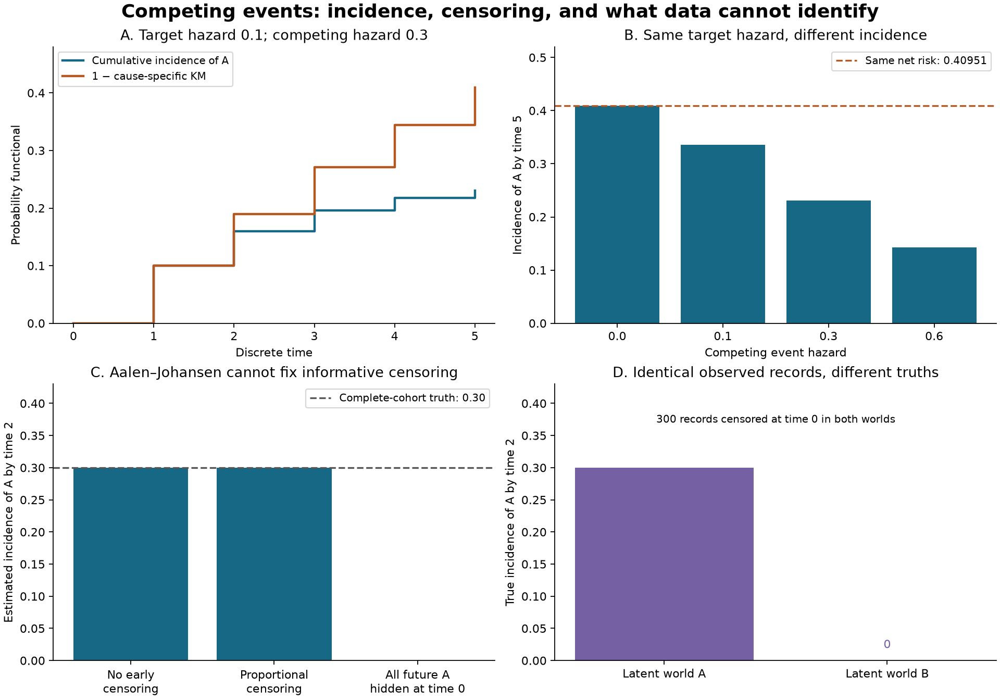

# Competing-event probabilities

Compute cumulative event probabilities from a baseline cohort with competing terminal events and right censoring. The implementation uses exact rational arithmetic for integer counting tables, an independent transition-matrix reference, and explicit examples of tie conventions and informative censoring.

The central distinction is between **the probability that a particular event occurs first** and **one minus a cause-specific Kaplan–Meier curve**. The latter is a different functional and need not form a coherent probability distribution across event types.

All examples are deterministic synthetic cohorts. There are no real subject records, clinical claims, financial performance claims, or private research data.

## Reproduce

Python 3.11 or 3.13:

```bash
python3 -m venv .venv
source .venv/bin/activate
python -m pip install -r requirements-repro.txt
python -m pip install --no-deps .
python -m pip check
python -m pytest -q
python examples/run_demo.py --output results
competing-events examples/counts.json
```

The core uses only the Python standard library. Matplotlib and NumPy are used for the figure, and pytest runs verification. `requirements-repro.txt` pins the reproduction environment. GitHub Actions installs the package and runs tests, the example, and the CLI on both Python versions.

## Counting-table model

All members enter at baseline. Each member has one observed terminal-event or right-censoring record. Times are nonnegative **integer ticks**, with arbitrary but consistent units; the library does not round or convert continuous times. Every cause has a declared label. Each table row contains:

- A distinct observation time, in strictly increasing order.
- One nonnegative integer event count per cause.
- A nonnegative integer censoring count.

All initial members must be accounted for. Members still event-free at the end of follow-up need an administrative censoring record. Empty rows are rejected. `from_records` aggregates unsorted individual records; `cause=None` denotes censoring. It retains declared causes with zero observed events.

At a tied time, **events use the risk set before removing either events or censoring**, then both are removed from the next risk set. This is an explicit event-before-censor convention. If timestamps were coarsened and ordering within a bin is unknown, the counts alone cannot resolve that ambiguity.

For example, 10 at risk with 2 events of A, 3 events of B, and 5 censorings at the same time give incidence estimates 0.2 and 0.3, with survival 0.5. Removing censorings first would use a denominator of 5 and instead produce 0.4 and 0.6. That changes the convention and the implied observation process. Zero members remaining under observation does not imply zero estimated survival.

## Computation

Let $Y_j$ be the pre-removal risk set and $d_{jk}$ the events of cause $k$ at time $t_j$. Starting from $S_0=1$ and $F_{0k}=0$, the competing-risk special case of Aalen–Johansen is

$$F_{jk}=F_{j-1,k}+S_{j-1}\frac{d_{jk}}{Y_j},\qquad
S_j=S_{j-1}\left(1-\frac{\sum_k d_{jk}}{Y_j}\right).$$

Censoring reduces the next risk set, not the event increment. In exact arithmetic, $S_j+\sum_k F_{jk}=1$ at every row. Each cause's incidence is nondecreasing. This implementation also reports

$$N_{jk}=1-\prod_{\ell\leq j}\left(1-\frac{d_{\ell k}}{Y_\ell}\right),$$

labeled `net_risk`: the complement of the cause-specific Kaplan–Meier functional treating other causes as censored. It satisfies $N_{jk}\geq F_{jk}$ here, but its values across causes can sum above one. It is not the observed competing-event incidence, and this project does not assign it a causal interpretation as an intervention removing competing causes. Such an interpretation needs additional assumptions.

With one cause, the incidence and net-risk calculations coincide with one minus Kaplan–Meier. In the absence of early censoring, incidence through the final administrative horizon is simply the proportion of the initial cohort experiencing that cause by the horizon.

All point estimates are `fractions.Fraction` internally and are serialized as strings such as `"3/10"`. **Exact arithmetic means exact calculations for the supplied counts, not statistical certainty.** There are no confidence intervals or hypothesis tests. The figure converts fractions to floating-point numbers for display.

Population interpretation requires appropriate independent right censoring and positive follow-up support. The unstratified estimator here does not adjust for covariates that might make censoring conditionally independent. Competing events themselves need not be independent of one another. Delayed entry, recurrent events, and general multistate histories are outside this model.

## Synthetic experiments



### Same cause-specific hazard, different probability

A synthetic cohort of 100,000 has a target event-A hazard of 1/10 in each of five discrete periods. Event-B hazards vary across 0, 1/10, 3/10, and 3/5. All event counts are integers under these chosen settings; remaining members are administratively censored at time 5. These are exact constructed counts, not random Monte Carlo draws.

The A incidence changes with the B hazard even though A's hazard is held fixed. Here a discrete hazard means the conditional event probability within a period among those still event-free, not a continuous-time rate. Recorded endpoint results are:

| B hazard per period | A incidence by time 5 | A net-risk functional by time 5 |
|--:|--:|--:|
| 0 | 0.40951 | 0.40951 |
| 0.1 | 0.33616 | 0.40951 |
| 0.3 | 0.23056 | 0.40951 |
| 0.6 | 0.14251 | 0.40951 |

The net-risk functional remains $1-(9/10)^5$. This is a statement about different probability targets, not evidence of an estimated covariate effect.

### Balanced versus informative censoring

A separate 1,000-member complete cohort has 200 A and 300 B events at time 1, followed by 100 A and 150 B events at time 2; 250 remain event-free through time 2. The complete-cohort A incidence is 3/10.

The proportional example removes exactly 30% from **each latent outcome/time category** at time 0. Its incidence curve equals the complete curve algebraically. This is a balanced deterministic illustration, not a random independent-censoring simulation or a test of an independence assumption.

The informative example instead censors all 300 members who would experience A, before their events occur. The observed Aalen–Johansen estimate for A is then zero. Exact arithmetic cannot recover information hidden by this outcome-dependent censoring.

### Identical observed records, different latent truths

World A is the complete cohort above. In world B, the same 300 hidden members remain event-free through time 2 instead. Apply the same time-zero censoring to those members in both worlds: **the individual observed records are identical**, yet latent A incidence by time 2 is 3/10 in world A and zero in world B. The script constructs both record lists and asserts equality of their observed versions. This exhibits nonidentification without assumptions on censoring; it does not claim that all possible latent incidences are bounded by these two examples.

`results/summary.json` contains all counting-table estimates, exact fractions, the tie example, and the identical-observation check. `results/hazard_curves.json` contains the four discrete-hazard curves. JSON results reproduce byte-for-byte with the same code; image metadata and rendering may vary across environments.

## API and input contract

```python
from competing_events import EventRow, EventTable, estimate

table = EventTable(1000, ["A", "B"], [
    EventRow(1, [200, 300], 0),
    EventRow(2, [100, 150], 250),
])
curve = estimate(table)
print(curve.at(2))
print(curve.to_dict())
```

Queries are right-continuous: they include events at the queried time. Before the first observation time, survival is one and incidence zero. Queries beyond the last observation time are refused, even when the fitted curve is fully absorbed. This is a deliberately conservative API support rule, not a claim that a step-function estimator cannot be algebraically extended. A final survival mass above zero is not allocated among future causes.

The CLI reads the counting-table schema in `examples/counts.json`, optionally with `query_times`. It leaves the input unchanged and rejects duplicate/unknown fields, floats or booleans in integer fields, negative counts, inconsistent cohort totals, duplicate times, malformed labels, and files above 1 MiB. Exit codes: 0 success, 1 data/file error, 2 command-line usage error. All reported cause arrays follow the declared cause order.

Bounds keep exact arithmetic manageable: initial cohort 1–1,000,000,000; 1–8 causes; 1–200 nonempty time rows; integer times from 0 to 1,000,000,000; at most 10,000 records for aggregation and 1,000 CLI query times. Labels are distinct ASCII identifiers of at most 32 characters. The independent record-level reference is limited to 100 records and assumes validated input. Aggregate counts are never expanded into individual records by the production estimator.

## Verification and scope

The 58 tests check hand-derived fractions, conservation of total probability, monotonicity, net-risk inequalities, count-replication invariance, single-cause reduction, event/censor ties, query support, record aggregation, large aggregate cohorts, and invalid input handling. A separate reference recomputes each risk set directly from individual records and multiplies absorbing-state transition matrices; it does not use the production counting-table update. Its states match the production estimates exactly in the demonstrated reference example and ten seeded test cohorts.

The project estimates first-event incidence only. It does not fit cause-specific Cox or Fine–Gray regression, estimate standard errors, perform causal intervention analysis, adjust for informative censoring, infer missing causes, choose a tie convention from rounded data, or forecast beyond follow-up. Its examples are intended to demonstrate estimands and observation assumptions rather than validate a model against a real dataset.

## References and provenance

The code, counting tables, counterexamples, tests, and figure are written for this repository. No external dataset or private information is used.

- [R survival package: Multi-state models and competing risks](https://cran.r-project.org/web/packages/survival/vignettes/compete.pdf), by Terry Therneau, Cynthia Crowson, and Elizabeth Atkinson, develops the transition-matrix and cumulative-incidence interpretation of Aalen–Johansen.
- [Austin, Lee, and Fine, Introduction to the Analysis of Survival Data in the Presence of Competing Risks](https://pmc.ncbi.nlm.nih.gov/articles/PMC4741409/), explains why cause-specific hazards and cumulative incidence answer different questions. The examples here are generic synthetic counts, not the paper's data.

MIT licensed; see `LICENSE`.
